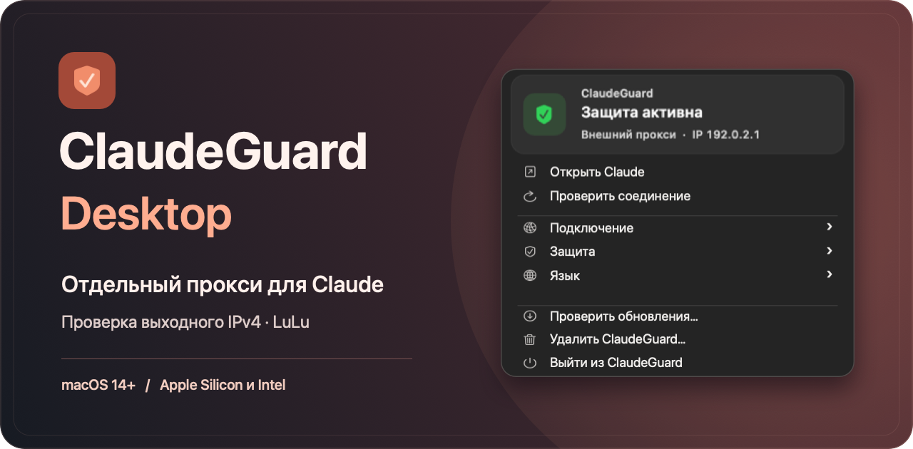
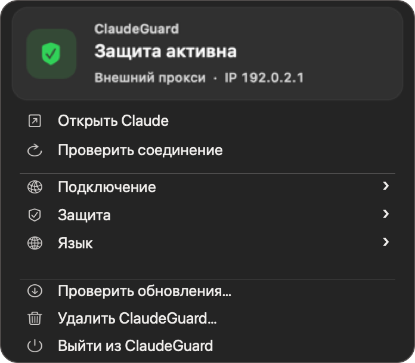

[**Скачать для macOS**](https://github.com/d6vmc/ClaudeGuard-Desktop/releases) · [**Установка на русском**](README.desktop.ru.md) · [**MIT**](LICENSE)

## Отдельное соединение для Claude Desktop

ClaudeGuard запускает SSH-туннель или Xray, сверяет выходной IPv4 и следит за правилами LuLu. При потере подтверждённого маршрута приложение закрывает Claude Desktop. После настройки Claude открывается обычной иконкой в Dock.

*Предпросмотр меню с демонстрационным IP.*

## Первый запуск

1. Скачайте **ClaudeGuard-Desktop.pkg**. Пакет рассчитан на **macOS 14+**, Apple Silicon и Intel.
2. Установите и активируйте внешний фильтр **LuLu**. Откройте **Защита → Настроить правила LuLu…** в ClaudeGuard.
3. Добавьте свой прокси с фиксированным публичным IPv4. Поддерживаются SSH, VLESS/REALITY и внешний прокси.
4. Настройте маршрутизацию macOS. Если используете Happ, добавьте его сетевой сервис и проверьте соединение при смене сервера. [Пошаговая инструкция](README.desktop.ru.md)

## Обновление и удаление

В меню есть **Проверить обновления…** и **Удалить ClaudeGuard…**. Обновление сохраняет настройки и проверяет SHA-256 пакета перед запуском установщика. Удаление запрашивает подтверждение и права администратора, восстанавливает настройки маршрутизации и удаляет файлы ClaudeGuard. Правила ClaudeGuard, импортированные в LuLu, можно удалить в LuLu. [Порядок удаления](README.desktop.ru.md#удаление)

## Исходный код

[Сборка пакета и устройство сетевой защиты](packaging/lulu-desktop/README.md) · [Дополнительные режимы](README.ru.md) · [Уведомления о сторонних компонентах](NOTICE)
