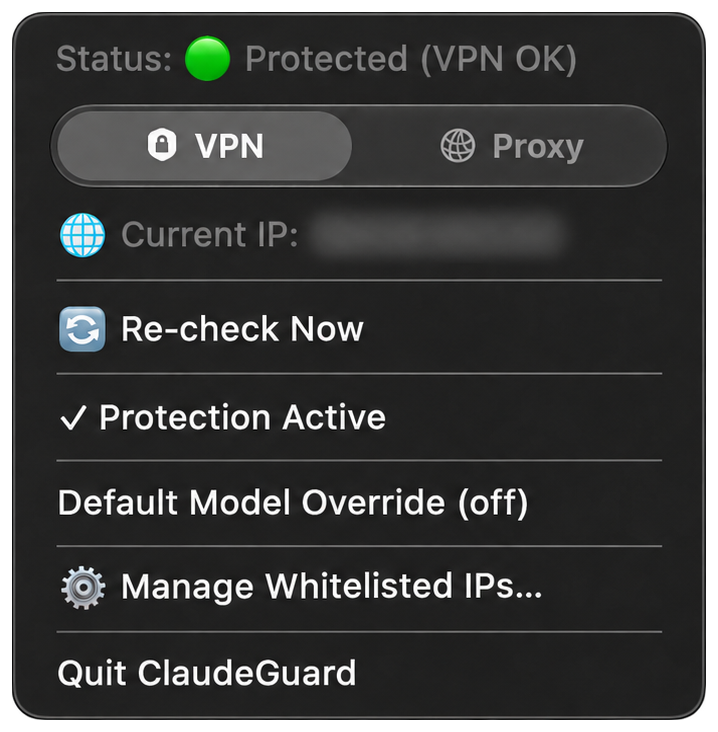
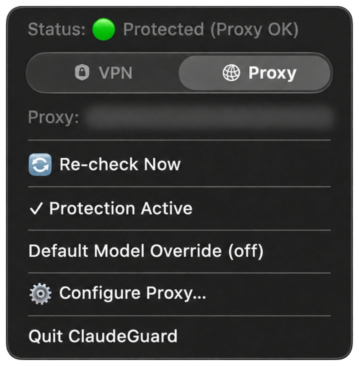

<div align="center">

# 🛡️ ClaudeGuard

**VPN-whitelist и проксирование Claude на macOS.**

Защита Claude Code CLI, Claude Desktop и известных адресов Claude/Anthropic через проверенный VPN или собственный прокси.

[English](README.md) · **Русский**

**Claude Desktop для macOS** · [Установка с нуля на русском](README.desktop.ru.md) · [Скачать Desktop](https://github.com/d6vmc/ClaudeGuard-Desktop/releases)




IP и адрес прокси на скриншотах скрыты.

</div>

## Возможности

- **VPN:** whitelist адресов IPv4/IPv6 и диапазонов CIDR. Перед разрешением защищаемого трафика проверяются маршрут VPN и внешний IPv4. Отдельной проверки VPN для IPv6 пока нет: защищаемые IPv6-адреса остаются заблокированы.
- **Proxy:** HTTP/HTTPS, SOCKS4/4a/5, Shadowsocks, VMess, VLESS/Reality, Trojan, Hysteria2 и TUIC через sing-box. Для сложных протоколов и транспортов используется outbound JSON.
- **Меню в строке macOS:** статус, переключатель VPN/Proxy, управление защитой, whitelist и прокси. Щит отображается сразу при запуске; переключатель не вызывает тактильную отдачу трекпада.
- **Нативные окна настроек:** копирование и вставка; текущий прокси подставляется и выделяется. Сохранение пустого поля удаляет профиль. Пустой whitelist или отсутствующий профиль блокирует доступ в соответствующем режиме.
- **Claude Code:** проверка перед запуском, наблюдение за работающими сессиями, необязательная подстановка `--model`.
- **Автозапуск и восстановление перехватов:** демон периодически проверяет CLI/Desktop; команда `doctor` проверяет и восстанавливает их вручную.

## Установка

### PKG

1. Соберите стандартный `ClaudeGuard.pkg` по инструкции ниже и откройте его.
2. Устанавливайте из аккаунта, в котором будете пользоваться ClaudeGuard. Потребуется пароль администратора.
3. Откройте щит в строке меню и настройте режим:
   - **VPN:** подключите VPN и добавьте его внешний IP через **Manage Whitelisted IPs…**. Не добавляйте случайно IP обычного подключения.
   - **Proxy:** откройте **Configure Proxy…**, сохраните URL или outbound JSON и укажите фиксированный публичный IPv4 прокси. Для существующего профиля также потребуется указать этот адрес.

Пакет предназначен для **macOS 14+**, содержит бинарники **Apple Silicon и Intel**, а также **sing-box 1.14.4**. При установке PKG движок не скачивается. Для `/usr/bin/python3` нужны **Xcode Command Line Tools**: если их нет, сначала выполните `xcode-select --install` и дождитесь завершения. При обновлении настройки сохраняются. В новой установке whitelist пуст, профиль прокси отсутствует.

По умолчанию приложение и хелперы имеют ad hoc подписи, а PKG не подписан Developer ID и не нотариализован. Для скачанного пакета, которому вы доверяете, macOS может потребовать **Системные настройки → Конфиденциальность и безопасность → Всё равно открыть**.

### Из исходников

Из локальной копии проекта:

```bash
./install.sh
```

Или с загрузкой установщика и исходников с GitHub:

```bash
bash -c "$(curl -fsSL https://raw.githubusercontent.com/d6vmc/ClaudeGuard-Desktop/main/install.sh)"
```

Установщик компилирует Swift/C для текущего Mac и скачивает движок с GitHub с проверкой закреплённого SHA-256. Нужны интернет и Command Line Tools. Права администратора используются для приложения и сетевого хелпера. Предложение добавить текущий IP относится только к VPN; Proxy можно настроить позже в меню.

### Сборка PKG

```bash
./build.sh
# Другая версия пакета:
./build.sh 2.0.1
```

Результат — `ClaudeGuard.pkg` в корне проекта. Версия по умолчанию — **2.0.0**. Каждая сборка скачивает обе закреплённые архитектуры движка, объединяет их и включает в пакет вместе с лицензиями и установочными скриптами. Сборка не устанавливает приложение и не меняет firewall. Подробнее о подписи и совместимости: [packaging/README.md](packaging/README.md).

### Удаление

```bash
claudeguard uninstall
# Если команда недоступна:
bash ~/.local/share/ClaudeGuard/uninstall.sh
```

Из полного checkout также работает `./uninstall.sh`. Удаление требует прав администратора, останавливает сервисы ClaudeGuard, удаляет его PF anchor, секции hosts и CLI-перехваты. Чужие команды и ссылки `claude` сохраняются. Ссылка на сохранённый оригинальный бинарник восстанавливается только при его наличии; сам Claude не скачивается и не устанавливается.

## CLI

| Команда | Действие |
|---|---|
| `claudeguard status` / `check` | Показать статус / код выхода 0 при разрешённом доступе, иначе 1 |
| `claudeguard add-ip <ip-or-cidr>` | Проверить и добавить адрес или диапазон |
| `claudeguard remove-ip <entry>` / `list-ips` | Удалить точную запись / показать whitelist |
| `claudeguard set-proxy` | Прочитать URL или outbound JSON из stdin; пустой ввод удаляет профиль |
| `claudeguard set-exit-ip <IPv4>` | Задать ожидаемый публичный IPv4 для режима Proxy |
| `claudeguard use-proxy` / `use-vpn` | Выбрать режим |
| `claudeguard enable-protection` / `disable-protection` | Включить / отключить защиту |
| `claudeguard set-model <model>` | Задать и включить модель по умолчанию для CLI |
| `claudeguard enable-model` / `disable-model` | Включить / отключить подстановку модели |
| `claudeguard launch-desktop` | Запустить Desktop с предварительной проверкой |
| `claudeguard start` / `stop` | Запустить / остановить демон меню; остановка не очищает firewall |
| `claudeguard doctor` | Проверить и восстановить перехваты CLI/Desktop |
| `claudeguard install-cli-wrapper` | Восстановить CLI-перехват |
| `claudeguard set-cli-path <path>` | Указать настоящий исполняемый файл Claude CLI |
| `claudeguard uninstall` | Запустить удаление |

Для настройки запустите `claudeguard set-proxy`, вставьте профиль и завершите ввод Ctrl+D. Не помещайте настоящие пароли в историю shell или примеры для коммита.

## Сетевой фильтр Claude Desktop

Ветка с фильтром добавляет отдельную сборку для macOS 15+. Фильтр проверяет подпись Anthropic процесса и пропускает его исходящий TCP только к локальному прокси ClaudeGuard. Команда запуска Desktop задаёт этот прокси для Electron и проверяет состояние фильтра и выходной IPv4. Подробнее о подписанной сборке и проверке с Happ в [инструкции для тестирования](packaging/desktop-filter/README.md).

## Защита сети и ограничения

Пользовательский демон записывает `allowed`, `blocked`, `offline` или `disabled` в `~/.config/claudeguard/state.json`. Проверки запуска читают этот вердикт; в VPN возможна собственная резервная проверка IP. ClaudeGuard реагирует на сетевые события macOS и дополнительно проверяет соединение каждые 3 секунды. Завершение процессов происходит после подтверждения состояния `blocked` и не является мгновенным. Уже работающие процессы не завершаются только из-за перехода в `offline`.

Root-хелпер управляет отдельным PF anchor `com.claudeguard` и своим token включения PF. Глобальное отключение PF и очистка всех соединений не используются. Сбрасываются состояния соединений к защищаемым адресам. Разрешение VPN привязывает состояния к проверенному интерфейсу `utun`. DNS-запросы A/AAAA выполняются параллельно с резервными резолверами и общим дедлайном 2,5 секунды; тёплого DNS-кэша нет.

Proxy использует отдельный `utun199` и локальный вход CLI `127.0.0.1:17943`. Перехваченный TCP идёт через настроенный прокси, а UDP отклоняется. Для защищаемых адресов PF разрешает трафик только через `utun199` и привязывает состояния соединений к этому интерфейсу. Системные настройки прокси и маршрут по умолчанию сохраняются. Основной VPN может служить каналом до прокси.

Системный хелпер проверяет настроенный публичный IPv4 через отдельный локальный вход до запуска рабочего прокси. Системная служба повторяет проверку и останавливает sing-box при обнаружении сбоя или смены IP. CLI и лаунчер Claude Desktop требуют свежего подтверждения перед запуском. При загрузке macOS хелпер пытается восстановить блокировку PF для последнего набора известных адресов до повторной проверки прокси.

**Защита охватывает известные и разрешённые через DNS адреса.** Маршруты к общим CDN могут затронуть другие приложения. Для системного DNS, неизвестных назначений, вспомогательных процессов и отдельного браузера нужна изоляция по приложениям. Периодическая проверка обнаруживает смену IP только после её наступления. Для приёмки нужны проверка фиксированного IPv4 на сервере и захваты трафика при IPv4, IPv6, DNS, UDP, перезагрузке и переключении Happ. Режим VPN продолжает использовать свой список разрешённых IP и правила PF.

## Файлы, приватность и диагностика

- Приложение: `/Applications/ClaudeGuard.app`.
- Пользовательские файлы: `~/.local/share/ClaudeGuard`.
- Конфигурация: `~/.config/claudeguard/config.json`; пароли прокси хранятся открытым текстом, не в Keychain. Конфиг и приватные staging-файлы имеют права `0600`, их каталоги — `0700`.
- Root-компоненты: `/Library/Application Support/ClaudeGuard`; конфиг движка содержит credentials с правами `0600` и может оставаться после остановки движка.
- Логи: `/tmp/claudeguard.err`, `/tmp/claudeguard-helper.err` и доступный root лог `/Library/Application Support/ClaudeGuard/proxy.log`.
- Тайминги: `"trace": true` в конфиге или `CLAUDEGUARD_TRACE=1` в окружении соответствующего процесса. Файл — `~/.config/claudeguard/trace.log`. Имена хостов маскируются, IP и credentials не записываются; по умолчанию трассировка выключена.

## Разработка

```bash
python3 -B -m unittest discover -s tests
python3 -B tests/check_menu_mode.py
# Необязательный локальный интеграционный тест движка:
CLAUDEGUARD_TEST_ENGINE=/path/to/sing-box python3 -B -m unittest discover -s tests
```

Большинство unit-тестов используют моки или временные файлы и не доказывают работу реального PF/TUN. Ручные live-тесты в `tests/` запускаются отдельно и могут менять систему: сначала прочитайте их.

Основные компоненты: `src/main.swift` и `ModeSegmentedControl.swift` (UI), `brain.py` (вердикт), `config.py`, `ip_checker.py`, `network_guard.py` (запросы/DNS), `pf_controller.py` и `pf_anchor.c` (PF), `proxy*.py` (профили/движок), `integrity.py` (перехваты), `cli_wrapper.py`, `app_launcher.py`, `bin/claudeguard`. Root-компоненты обновляются установщиком; одного копирования пользовательских Python-файлов недостаточно.

## Лицензия

ClaudeGuard — **MIT**, см. [LICENSE](LICENSE) и [NOTICE](NOTICE). sing-box **v1.14.4** сохраняет [свою лицензию](src/vendor/SING_BOX_LICENSE), включая дополнительное условие об имени и указании связи с проектом: [исходники](https://github.com/SagerNet/sing-box/tree/v1.14.4), [архив](https://github.com/SagerNet/sing-box/archive/refs/tags/v1.14.4.tar.gz). Полные тексты и уведомления включены в обе установки. Определения Apple PF сохраняют [Apple Public Source License](src/vendor/APPLE_LICENSE).
